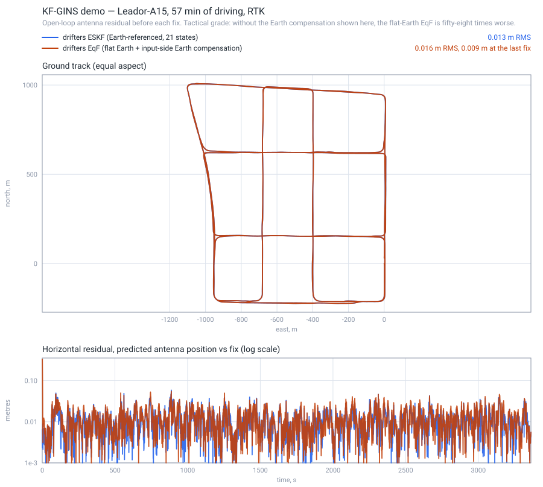
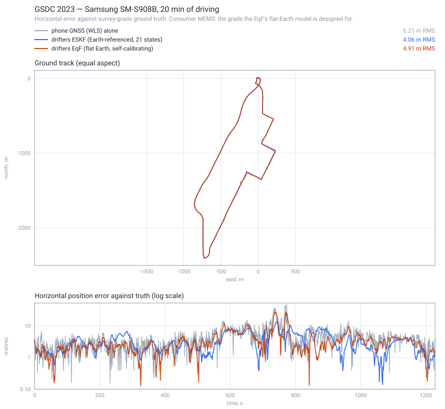

# drifters

An aided inertial navigation library producing extended pose estimates —
position, velocity, attitude — along with the sensor errors that corrupt it.
Rust `no_std` and allocation-free, from a microcontroller on up.

*Aided* because the IMU drives the propagation with corrections from GNSS,
barometric, magnetic, and odometric. *Extended* pose because velocity is a state
and not a by-product.

Two estimators share one interface:

- An **error-state Kalman filter**, 21 states, after
  [KF-GINS](https://github.com/i2Nav-WHU/KF-GINS). A local-level (NED) strapdown
  mechanization with feedback after every measurement. GNSS enters as a fix or
  as per-satellite pseudoranges.
- An **equivariant filter**, 21 states, after Fornasier et al. (ICRA 2024). It
  linearises at a fixed origin rather than at the moving estimate, and spends
  six states on self-calibration, recovering the GNSS antenna lever arm from a
  zero start. The ESKF must be told it.

Both are `no_std`, allocation-free and sans-IO, and both are measured bare-metal
under QEMU.

## Test-enforced Performance

| | measured |
|---|---|
| **Accuracy** | **1.3 cm** horizontal, 1.8 cm vertical RMS over 57 minutes of real driving |
| | 683 k IMU samples at 200 Hz, 3 413 RTK fixes, replayed in 2.3 s[^machine] |
| | per-axis bias below 1 mm |
| **Footprint** | **8.3 KiB** peak stack (15-state), 12.9 KiB (21-state), on Cortex-M4, late fixes included |
| | 15.3 KiB for the equivariant filter's engine, under a 20 KiB ceiling |
| **Safety** | the data path links **zero** `core::panicking` symbols |
| **Dependencies** | **one** on the filter path: `libm`. Protobuf adds `micropb` and `heapless`; `defmt` and `serde` are opt-in features |
| **Estimators** | two, behind one trait: a 21-state **ESKF** and an **equivariant filter** |
| **Tests** | 854 with every feature on, leaving out the opt-in `drifters-interop` adapters, plus fuzzing and a bare-metal QEMU harness |

[^machine]: The release-build regression test, file parsing included, on a
    Lenovo Slim 7x: Qualcomm Snapdragon X Elite, 12 cores, 16 GB LPDDR5X, Linux under WSL2, Rust 1.100.

Accuracy is an open-loop check: the filter's predicted antenna position at each
fix's epoch, before the fix is applied, so between fixes it runs on inertial
dead reckoning alone. Against KF-GINS's own reference solution the same run
agrees to 1.2 cm, 0.003 m/s, and 0.018° of heading. Method, tolerances, and what
that reference is and is not independent of are in
[docs/testing.md](docs/testing.md#layer-6--golden-dataset-regression).

### Work per IMU sample

Instructions per `add_imu`, the mean of 200 steps, on the two cores the harness
emulates. This is what decides whether the filter fits a microcontroller:

| | Cortex-M4, `f64` in software | Cortex-M7, `f64` in hardware | Cortex-M7, `opt-level = 3` |
|---|---|---|---|
| ESKF, 21-state | 1 599 280 | 89 320 | 61 400 |
| ESKF, 21-state, `f32-covariance` | 349 840 | 87 200 | 61 120 |
| ESKF, 15-state (`reduced-state`) | 885 560 | 56 200 | 32 600 |
| ESKF, 15-state, `f32-covariance` | 232 080 | 54 240 | 31 840 |
| EqF engine, dense `f64` | 4 509 840 | 277 400 | 112 160 |
| EqF engine, factored `f32` | 893 520 | 333 920 | 150 800 |
| EqF engine, dense, Earth in the group | 4 723 520 | 284 800 | 115 320 |
| EqF engine, factored, Earth in the group | 914 520 | 336 520 | 151 360 |

Measured under QEMU with `-icount shift=0`, so the counts are exact. They are
**not** cycle counts — QEMU models no pipeline, cache, or FPU latency — so they
measure the work a change removes, not the time it takes. Details in
[docs/testing.md](docs/testing.md#instructions-retired).

## Two estimators, compared

The library ships an error-state Kalman filter and an
[equivariant filter](docs/eqf.md) over shared mechanization and shared Lie group
machinery. Both ran on the same two datasets, from the same inputs, scored the
same way.



**Tactical grade.** The EqF as published assumes a flat, non-rotating Earth, and
this IMU can see the Earth turn: its gyro's bias prior is 0.027 °/h, and Earth
rate is 557× that. Half of it the filter absorbs. Uncompensated, its gyro-bias
state converges to −3.66 × 10⁻⁵ rad/s about the body's vertical axis, against
the 3.69 × 10⁻⁵ of Earth rate that is vertical at this latitude, and for a
level car that half does not change as it turns. The horizontal half does, and
no state can follow it. The 1 Hz RTK fixes hold what is left to 0.94 m, with a
NIS of 6 718: bounded, and very confident about the wrong thing.

Compensating the input — gyro by `R̂ᵀ(ω_ie + ω_en)`, accelerometer for Coriolis —
takes it to **1.6 cm** with a NIS of 1.55, against the ESKF's 1.3 cm and 1.46:
fifty-eight times better than uncompensated, and 28 % short of an
Earth-referenced filter. The replay picks that for this IMU by itself, from
the gyro's grade, as [adr/0008](docs/adr/0008-earth-model-by-sensor-grade.md)
decides.

**Navigation grade.** A gyro this good can find north from the Earth's rate, and
compensating the input throws that away. `EqfOptions::earth_in_group` puts the
rotation in the filter's group instead. In simulation, a still 0.003 °/h unit
starting 3° off finds north to **0.026°** in 15 minutes, level with the ESKF's
0.025°, where the compensated filter stays about 4° off. The model holds at or near
its anchor. For a unit that travels, use the ESKF. No navigation-grade IMU has been
run through it.

The EqF has no scale-factor states, so the −260 ppm vertical accelerometer scale
factor the ESKF estimates reaches it as a 250 mGal bias, seventeen sigma outside an
ordinary bias prior. The replay carries that scale factor in the prior, and the GCU
covariance update is the paper's, counting the inflation as measurement noise. With
both, every GCU rate converges. See
[docs/eqf.md](docs/eqf.md#what-the-compensated-filter-needs).

The EqF also calibrates the GNSS antenna lever arm, where the ESKF is handed it
from config. Started with no lever arm in its prior at all, it holds zero until
the car moves and then finds `[+0.162, −0.305]` m horizontally against a
configured `[+0.136, −0.301]`. The 2.6 cm along the vehicle is the
configuration's error, not the filter's. With the configured arm the ESKF's
residual across the vehicle follows the yaw rate, 7.5 mm one way in left turns
and 5.4 mm the other in right ones, which is what an arm wrong along the
vehicle does; handed the EqF's it stops, and every fix is predicted better,
1.28 to 1.21 cm. The ESKF cannot estimate the lever arm at all. The evidence is
[a test](docs/testing.md#what-the-recording-says-about-its-lever-arm).



**Consumer grade**, where the flat-Earth assumption holds. A phone gyro drifts
at about 20 °/h, so Earth rate sits below its noise floor rather than 557× above
it. No Earth compensation is applied; this is the paper's filter as written.

Horizontal RMS against survey-grade truth, in metres. The process-noise scale
was fitted on **trace A only** and applied unchanged to three held-out traces
from the same phone, so B, C, and D are out-of-sample. Bold marks the rows that
beat doing nothing.

| | A *(fitted)* | B | C | D |
|---|---|---|---|---|
| phone GNSS (WLS) alone | 6.21 | 3.78 | 2.82 | 4.03 |
| ESKF, consistent tuning ×95 | **5.71** | 5.51 | 3.41 | **3.55** |
| EqF, consistent tuning ×36 | **4.54** | **3.49** | **2.04** | **3.04** |
| ESKF, hand-picked ×300 | **4.06** | 4.11 | **2.09** | **3.32** |
| EqF, hand-picked ×300 | **4.91** | **3.05** | **1.84** | **3.22** |

Trace A is the easy case, and fitting on it overstates everything. Its GNSS is
the worst of the four by a wide margin, 6.21 m against 2.8 to 4.0, which leaves
the most room for an IMU to help. For the ESKF the tuning fitted there does not
transfer: at ×95, fusion is worse than raw GNSS on traces B and C. The EqF
beats raw GNSS on all four traces at either tuning.

The EqF leads the ESKF at the A-fitted tuning, and that part generalises: it is
ahead on all four traces, by 21 %, 37 %, 40 % and 14 %. At ×300, the ESKF's
own tuning, the EqF is ahead on the three held-out traces and behind on A.

For the ESKF the hand-picked ×300 generalises better than the consistent one,
despite a mean NIS of 0.47. Either model error absorbs the extra process noise,
or heavy-tailed multipath innovations drag the mean NIS around. `drifters tune`
reports a median crossing as well, which separates the two and rejects the
second: the innovations are heavy-tailed, at a mean-to-median ratio of 2.1–3.3
against the 1.27 a chi-squared gives, but correcting for it moves the ESKF's
consistency point the wrong way, to ×58. Unmodelled error is what remains, and
the ESKF wants five times more process noise than consistency supports. The
EqF does not: its median crossing, ×17, sits next to its lowest error, ×14.

On a phone, over one-second fix intervals, inertial fusion buys between nothing
and about 35 % depending on the trace and the filter, and a tuning fitted on
one trace can make it negative on another.

The EqF's generalised covariance union is what its lead is built on. Its
convergence rate α, the knob that replaces χ² rejection, is best at 0 on seven
of eight trace and tuning combinations; and α = 0 is not off — it still
inflates — while turning it off costs 4 to 36 % everywhere. Larger α helps on
trace A at ×300 and does not survive the held-out traces. Sweeps in
[docs/eqf.md](docs/eqf.md#gcu-measured-on-four-traces) and
[docs/gsdc.md](docs/gsdc.md).

Every value on both figures comes from the replay. To regenerate them:

```bash
cargo run --release -p drifters-cli -- replay --engine eskf,eqf --config datasets/kf-gins/kf-gins.yaml --compare docs/figures/kf-gins-comparison.svg
```

```bash
cargo run --release -p drifters-cli -- gsdc --dir datasets/gsdc2023 --sigma-n 5.7 --sigma-e 2.5 --sigma-v 18 --imu-scale 300 --compare docs/figures/gsdc-comparison.svg
```

Every replay takes `--engine eskf`, `eqf` or `eskf,eqf`, and runs each through
the same loop. The table above is `drifters tune --dir <trace>`, which sweeps
both.

The per-filter diagnostic figures, with NIS, come from `drifters plot` and
`drifters gsdc --figure`. Filter consistency means NIS *scattered about 3*, not NIS
*small*.

### What made the phone result work: the GNSS, not the filter

Position-only aiding gains **1.7 %** over the phone's own GNSS on that trace, and
un-tuned it is *worse* than doing nothing. Heading is weakly observable from
position alone, so a phone gyro's drift injects error faster than 1 Hz fixes remove
it. Solving a **Doppler velocity** from the dataset's pseudorange rates raises the
gain to 34.7 %. The table above is still not the best this repository does with the
same files.

The dataset ships raw observables, and most of the gain comes from using them, not
from the filter:

| what changed | competition score, four traces |
|---|---|
| the phone's own `WlsPosition*` columns | 4.99 |
| solve position from the raw pseudoranges instead | 3.90 |
| refit the tuning the better GNSS made stale | 3.04 |
| replace the Doppler velocity with time-differenced carrier phase | 2.86 |
| **fit the pseudorange positions and carrier deltas together** | **2.47** |

Score is the competition metric, the mean of the 50th and 95th percentile
horizontal error, and every row is trace A's tuning applied unchanged to three
held-out traces.

The last row **uses no IMU at all**. On a 1 Hz phone trace, fitting the file's
two GNSS observables against each other beats fusing either of them with the
phone's inertial sensors, on every one of the four traces. That is worth
stating plainly rather than burying: this hardware's IMU needs its noise
inflated 400× to be usable, and what it contributes between GNSS epochs is a
trajectory shape the carrier phase measures directly and 2000× better. The
batch fit is non-causal, so it is a different product rather than a competitor
— but it settles where the remaining error lives.

Three properties of this data matter more than the number:

- **The cycle-slip flag is never set**, on any of the four traces, while 8.1 %
  of carrier pairs are in fact slipped. The `State` bits on the pseudoranges are
  just as uninformative.
- **A delta is not a velocity at either endpoint.** Handing the filter
  `delta/dt` throws away the whole advantage, leaving a lagged carrier velocity
  no better than Doppler, because a delta belongs to its interval's midpoint.
- **A solve cannot always tell that it has failed.** About one epoch in a
  hundred comes out confidently wrong, and neither its residual scatter nor its
  geometry shows it. Only an independent second solution does.

Full diagnosis in [docs/gsdc.md](docs/gsdc.md) and
[docs/gsdc-observables.md](docs/gsdc-observables.md).

## Status

**Working and validated:** core math, strapdown mechanization, the ESKF at 21 or 15
states, loosely and tightly coupled GNSS, RTS smoothing, auxiliary sensors (ZUPT,
non-holonomic constraints, odometer, barometric height, three-axis magnetometer with
hard and soft iron calibration), IMU-to-vehicle mounting estimation, initial
alignment, protobuf serialization, bare-metal Cortex-M, KF-GINS dataset regression.

The equivariant filter runs end to end on both datasets: symmetry group, lift,
linearisation, group exponential, GCU, and the propagate/update loop, with every
Jacobian checked against a numerical one. `EqfEngine` is driven exactly as the
ESKF's engine is: sans-IO, validated configuration, the IMU sample split at the GNSS
epoch, gated updates. Both engines implement
[`Estimator`](crates/drifters-core/src/estimator.rs), and one contract test runs
against the pair. A fix that arrives late is applied by rewinding for either one,
through the same generic layer in `drifters-core`, and every dataset replay above
runs whichever engine `--engine` selects through one loop.

The paper cannot be transcribed as printed: there are
[six places the source cannot be taken literally](docs/eqf.md#six-places-the-source-cannot-be-taken-literally),
each with a test that fails under the other reading. One shows only away from the
identity element, where `Â = I` makes a body-frame rate and a global-frame rate the
same expression.

**Not done:** timing on real silicon, and any run on a physical IMU. Everything is
dataset replay plus emulation. [`cortex-m-hil`](cortex-m-hil) is the firmware for
both, built and checked under emulation, and it has never been on a board.
[docs/milestones.md](docs/milestones.md) lists the open work.

What emulation does say about timing is a floor, and it is not a comfortable
one. An IMU sample costs 1.6 million instructions in the default build on a
Cortex-M4, because that core's FPU is single precision and the filter's `f64`
runs in software: at least 9.5 ms at 168 MHz, so it cannot follow a 200 Hz IMU
there. `--features f32-covariance` removes 78 % of that, to 350 thousand, with
no measurable change in any result, and is the configuration to use on that
part. The equivariant filter is 4.5 million dense, and 0.89 million with its
covariance factored and held in `f32`, again with no measurable change.

A Cortex-M7 with a double-precision FPU is a different problem, once built with
`-C target-cpu=cortex-m7`. The same sample is 89 thousand instructions for the
ESKF and 277 thousand for the dense equivariant filter. `f32-covariance` then
saves under 3 %, and the factored `f32` filter costs 20 % more than the dense
one. Those are instruction counts, and double-precision instructions take that
core longer, so which build is fastest there needs a board.

## Layout

```
drifters-core      no_std, no alloc, deps: libm
                   fixed-size matrices, quaternions, WGS-84, frames, time,
                   and the Estimator trait both engines implement
drifters-filter    no_std, no alloc — mechanization, 21-state ESKF, GinsEngine
drifters-proto     no_std — protobuf codecs (micropb), codegen needs no protoc
drifters-eqf       no_std, no alloc — equivariant filter, Lie groups,
                   self-calibration, EqfEngine
drifters-interop   std ONLY — nav-types / gnss-rtk adapters, opt-in
drifters-gnss      std — robust positioning, carrier phase, RINEX, trajectory fit
drifters-cli       std — replay, estimator comparison, NEES, and tuning
examples/rtic-imu  firmware — IMU interrupt to engine to telemetry under RTIC,
                   run on QEMU's STM32F405 in CI
cortex-m-harness   firmware — stack, size, and panic measurements under QEMU
cortex-m-hil       firmware — DWT cycle counts and a live IMU on a NUCLEO-H743ZI2
```

## Quick start

```bash
cargo add drifters-core drifters-filter
cargo add drifters-eqf  # if using the EqF as well
```

```rust
use drifters_core::prelude::*;
use drifters_filter::{GinsEngine, GinsOptions};

let mut engine = GinsEngine::new(GinsOptions::default())?;

// Push samples in, pull state out. No allocation, no threads, no clock.
// After the first IMU sample has established the clock, queue a fix
// before supplying the sample whose interval contains its epoch.
let queued = engine.add_gnss(gnss_fix);
engine.add_imu(imu_sample)?;
let solution = engine.nav_state();
```

The [working consumer example](examples/consumer/src/main.rs) feeds both engines
through `&mut dyn Estimator` using only public crate APIs. Run it from this
checkout with `cargo run -p drifters-consumer-example`.

On a device the IMU often has passed it: a receiver reports a fix after the
epoch it describes. `drifters_filter::RewindEngine` wraps the engine and applies
a late fix by rewinding, bit-identically to on-time delivery;
`drifters_eqf::EqfRewindEngine` does the same for the equivariant filter, with
the same code.

The options types are `#[non_exhaustive]`, so a new setting is not a breaking
change ([adr/0010](docs/adr/0010-non-exhaustive-settings.md)). Start from the
defaults and assign what differs:

```rust
let mut options = GinsOptions::default()
    .with_initial_state(position, velocity, attitude)
    .with_antenna_lever_arm(lever_arm);
options.max_consecutive_rejections = 20;
```

### Starting from nothing

Neither engine has to be told where it is. `drifters_core::align::Aligner` takes
the same IMU samples and GNSS fixes, levels and measures the sensor's biases
while the vehicle stands still, takes heading from the first stretch of driving,
and hands back the state with a sigma for every part of it. A gyro good enough
to see the Earth turn finds north without moving.

```rust
use drifters_core::align::{AlignConfig, AlignPhase, Aligner};

let mut aligner = Aligner::new(AlignConfig::new(imu_noise))?;

// In the IMU handler. Stand still for ten seconds, then drive.
if aligner.add_imu(&sample) == AlignPhase::Aligned {
    if let Some(alignment) = aligner.alignment() {
        let options = GinsOptions::default()
            .with_alignment(alignment)
            .with_imu_noise(imu_noise);
        let mut engine = GinsEngine::new(options)?;
        engine.add_imu(sample)?; // the sample the state is valid at
    }
}

// In the GNSS handler.
aligner.add_gnss(&fix);
```

`EqfOptions::with_alignment` does the same for the equivariant filter. It needs
a stationary start, so a launch already in motion will not align. What it
achieves, and how far its sigmas can be believed, is in
[docs/testing.md](docs/testing.md#layer-13--initial-alignment).

### Options from a file

With `--features serde` the same options read from a file on a host, and a
partial file takes the defaults for the rest. A misspelt setting is an error,
not a silent default:

```json
{ "antenna_lever_arm": [0.14, -0.02, -1.10], "max_consecutive_rejections": 20 }
```

### On a microcontroller

[`examples/rtic-imu`](examples/rtic-imu) is the firmware around the engine: an
IMU data-ready interrupt that timestamps and queues, the filter in a task the
interrupts preempt, a GNSS receiver whose fixes all arrive 120 ms late, and a
published solution. It runs on QEMU's STM32F405 board and checks its own result.
Its README works through how deep the IMU queue must be to absorb a rewind.
On a Cortex-M4F, use these features:

```toml
drifters-filter = { version = "0.1", features = ["f32-covariance", "defmt"] }
```

`f32-covariance` puts the covariance arithmetic on the single-precision FPU, and
`defmt` gives every public type a `defmt::Format` for logging. Neither feature
allocates. `defmt` is for firmware: a Windows host binary built with it does not
link under MSVC, because the logger and linker symbols it needs are missing there.

On a Cortex-M7 with a double-precision FPU, such as an STM32H7, build with
`RUSTFLAGS="-C target-cpu=cortex-m7"` to run `f64` in hardware. The target alone
assumes single precision and leaves it in software. Many Cortex-M7 parts do have
only single precision, and on those this flag makes the firmware fault, so check
the datasheet.

The equivariant filter is driven the same way, and code that does not care
which it has can take either:

```rust
use drifters_core::estimator::Estimator;
use drifters_eqf::{EqfEngine, EqfOptions};

fn step<E: Estimator>(estimator: &mut E, imu: ImuSample, fix: Option<GnssFix>) {
    if let Some(fix) = fix {
        let _ = estimator.add_gnss(fix); // applied at its own epoch, inside the interval
    }
    let _ = estimator.add_imu(imu);
}

let mut eqf = EqfEngine::new(EqfOptions::default())?;
step(&mut eqf, imu_sample, Some(gnss_fix));
step(&mut engine, imu_sample, None);
let lever_arm = eqf.lever_arm(); // estimated here; configured in `GinsOptions`
```

Reproduce the accuracy number yourself — no dataset is committed, so fetch it
first (67 MB, from the KF-GINS authors; the full index is
[docs/datasets.md](docs/datasets.md)):

```bash
mkdir -p datasets/kf-gins && cd datasets/kf-gins && for f in kf-gins.yaml GNSS-RTK.txt Leador-A15.txt; do curl -fLO "https://raw.githubusercontent.com/i2Nav-WHU/KF-GINS/main/dataset/$f"; done
```

```bash
cargo test -p drifters-cli --release --test kf_gins_regression -- --nocapture
```

## Design notes

- **21 error states** — position, velocity, attitude, gyro bias, accel bias,
  gyro and accel scale factors. `--features reduced-state` drops the scale
  factors for 15 states, halving every matrix for 4 % accuracy.
- **Quaternions** for attitude (Hamilton, scalar-first). Euler angles are output
  only, never round-tripped through.
- **Two-sample coning and sculling** compensation with midpoint earth terms.
- **Factored covariance** — `P` is stored as `U D Uᵀ` and updated by the Bierman
  and Thornton recursions, so it is never formed and never assembled by
  subtracting two nearly-equal matrices. Positive-definiteness is a property of
  the representation rather than something to test for and repair. Held states
  stay in the factors too, by one rank-one update per measurement row.
- **Sans-IO.** The engine never allocates, blocks, reads a clock, or touches a
  file. That is what lets the same code run inside an interrupt handler.
- **NED navigation frame, FRD body frame** — the navigation-literature
  convention, not ROS's ENU/FLU. Conversion belongs at the boundary; reasoning
  in [docs/adr/0006](docs/adr/0006-frame-convention.md).
- **`f64` for position**, deliberately — `f32` latitude costs 0.76 m per ULP
  against a 1.3 cm error budget. The *covariance* is a separate question, and
  because it is stored factored the answer differs: `--features f32-covariance`
  halves it to 924 bytes and puts its arithmetic on the Cortex-M4F's
  single-precision FPU instead of in soft-float — 78 % of the instructions
  an IMU sample costs there — with KF-GINS, GSDC, and NEES all unchanged. See
  [docs/adr/0005](docs/adr/0005-scalar-type.md).

## Minimum supported Rust

**1.85** for `drifters-core`, `drifters-filter` and `drifters-eqf` — the crates
that go on the target, which depend on nothing but `libm`, and on `defmt` and
`serde` only when asked — and for the host-side `drifters-gnss` and
`drifters-interop`. **1.88** for `drifters-proto`, forced by `micropb` and
`heapless`. CI builds every 1.85 crate at 1.85 on every push.

## Documentation

The docs carry the reasoning and the evidence, including where the filters do not
help.

- [design.md](docs/design.md) — architecture and resource budget
- [state-model.md](docs/state-model.md) — the 21-state error model, derived
- [frames.md](docs/frames.md) — coordinate frames and conventions
- [testing.md](docs/testing.md) — eighteen layers, and what each one can prove
- [gsdc.md](docs/gsdc.md) — where the filter stops helping, and why
- [comma2k19.md](docs/comma2k19.md) — a phone-class IMU with wheel speed, and what the aids buy in a GNSS outage
- [releasing.md](docs/releasing.md) — crates.io publish order and procedure
- [datasets.md](docs/datasets.md) — every external dataset and paper, and how to fetch it
- [milestones.md](docs/milestones.md) — what works, what CI checks, and what is open
- [adr/](docs/adr/) — decisions and why
- [papers/](docs/papers/) — the source papers: citations, DOIs, and how to fetch them

Three worth reading if you are evaluating this seriously:
[why an accelerometer bias and a tilt are the same measurement to a stationary
filter](docs/state-model.md), [why position stays `f64` while the covariance can
be `f32`](docs/adr/0005-scalar-type.md), and [why the frame is NED/FRD rather
than the ROS convention](docs/adr/0006-frame-convention.md).

## Licence

This is free and unencumbered software released into the public domain, under
[The Unlicense](UNLICENSE).

`drifters-interop`'s `gnss-rtk-interop` feature is **not** default and links
AGPL-3.0 code; enabling it places the AGPL's obligations on the combined work.
`cargo deny` enforces that boundary in CI. See
[adr/0003](docs/adr/0003-interop-boundary.md).
